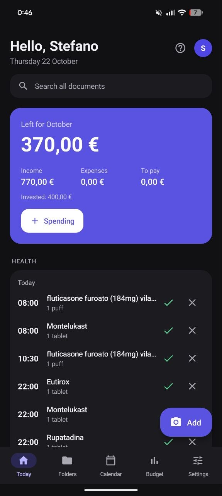
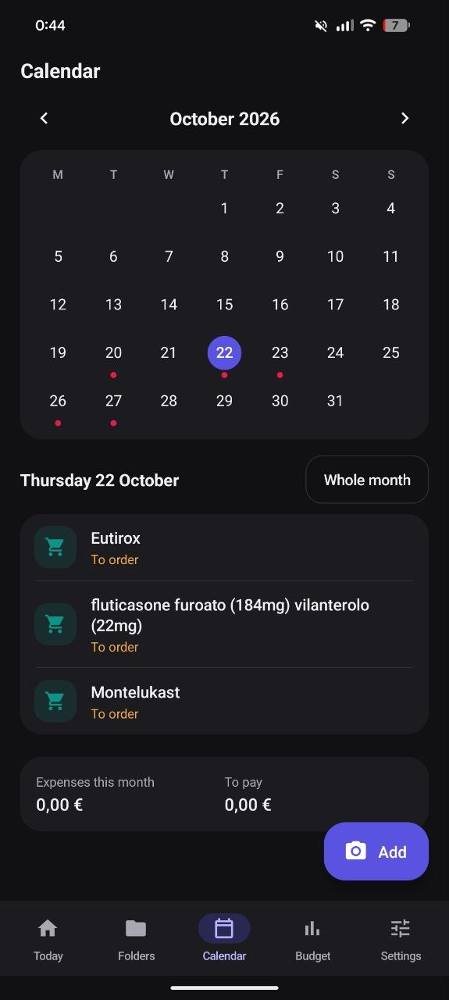
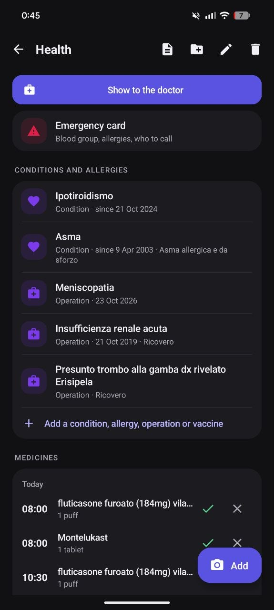
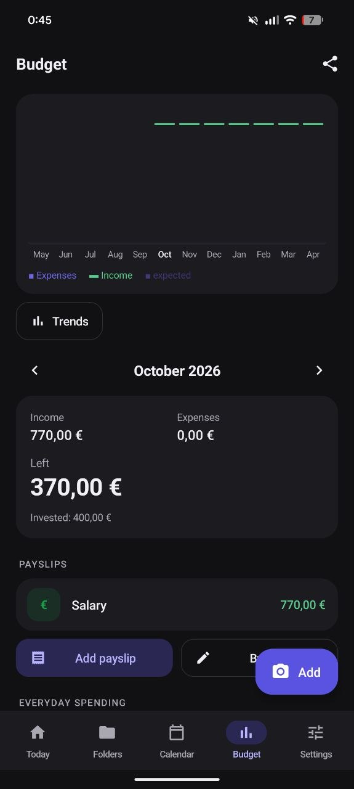
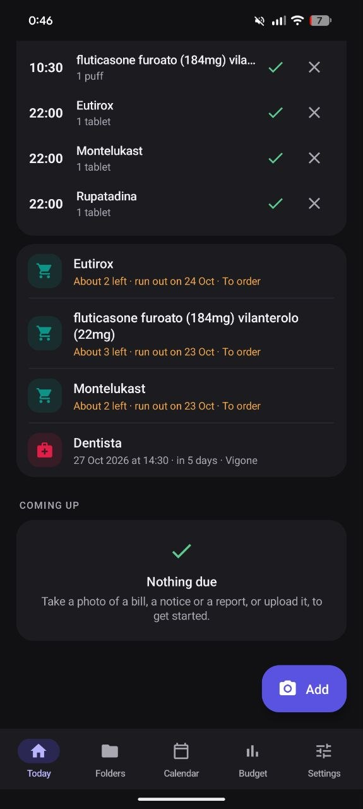

<p align="center">
  
</p>

<h1 align="center">PENSY</h1>

<p align="center">
  <b>Your paperwork, deadlines, money and health, in one app that has never seen the internet.</b>
</p>

<p align="center">
  <a href="#offline-by-construction"></a>
  <a href="../../releases/latest"></a>
  <a href="#under-the-hood"></a>
  <a href="core/test"></a>
</p>

<p align="center">
  <a href="../../releases/latest"><b>Download the APK</b></a> ·
  <a href="docs/manual.md">Manual</a> ·
  <a href="docs/faq.md">FAQ</a> ·
  <a href="README.it.md">Italiano</a>
</p>


<p align="center">
  
  
  
  
  
  
</p>

---

Every home has a drawer.

Bills. A medical report. The car tax notice. A warranty you will need exactly
once, three days after it expires. The payslip that arrived as a PDF and now
lives somewhere between your inbox and your Downloads folder. The drawer is not
an archive. The drawer is a promise you make to yourself that one day you will
sort it out.

PENSY is what happens when you stop making that promise.

You take a photo of the paper, or share the PDF. PENSY reads it, works out what
it is, files it in the right folder, keeps the QR code so you can pay at the
counter, and reminds you before the deadline. Then it counts the amount in this
month's budget, so you know how much money is *actually* left.

All of this happens on your phone. Not "on your phone and also, encrypted, on
our servers". On your phone. PENSY doesn't have Android's internet permission,
so it could not send your data anywhere even if it wanted to. There is no
account to create, no server to trust, and no company that can go bankrupt with
your medical history inside.

## Thirty seconds with PENSY

1. **Snap** a utility bill (or share the PDF from your email).
2. PENSY **reads** it on the phone: issuer, amount, due date, payment code.
   It sees the QR code too.
3. You **check** and tap Save. Nothing is ever stored without you seeing it first.
4. It lands in **Home › Electricity**. Ten days before the due date you get a
   reminder, then again the day before, then on the day.
5. You pay, attach the receipt, and the amount shows up in this month's
   **budget**.

The bill went into the drawer anyway. But now you never need to open it.

## Built for the final boss: Italian bureaucracy

PENSY was born in Turin, Italy, and if you want to stress-test a document
reader, Italy is a good place to start. In a single month you can get a
*pagoPA* notice (the national system for paying the public administration), the
*bollo* (yearly car tax), an *F24* (tax payment form), a hospital *ticket*
(healthcare co-pay), an electronic prescription whose *NRE* code you need at the
pharmacy, a utility bill with a QR code and a payslip, each with its own idea of
where the amount and the due date should go.

PENSY recognizes all of them, plus fines, medical reports, university fees,
insurance, warranties, receipts, subscriptions, ID cards, driving licences and
passports. Medical reports get a special treatment: if the doctor wrote "check
again in 12 months", PENSY proposes the reminder for you.

It reads English documents too, and the whole app is in Italian and English.

## What it does

**Paperwork**
- Photo or file wherever you add something. Multi-page documents, PDFs up to 12
  pages, sharing from WhatsApp or email.
- Automatic filing into folders and sub-folders (*Health › Heart*, *Car › Panda*)
  that learns from you: move one document from an issuer, and the next ones go
  there.
- The exact QR code or barcode is kept and redrawn, identical, to show at the
  counter.
- Full-text search across everything you've ever scanned.
- Text first: the photo is deleted after reading unless you choose to keep it.

**Deadlines**
- Calendar, recurrences, multi-stage reminders (90, 30 and 7 days before your ID
  card expires).
- Expiry dates read or computed for ID cards, licences and passports; warranties
  end two years after purchase; "cancel by" dates for subscriptions.

**Money**
- From your payslip: *"you have €X left this month"*.
- Everyday expenses in three taps, fixed costs with yearly totals, trends over
  months and years.
- A tracker for the *730* (the Italian tax return): medical, vet, school,
  transport and kids' sports expenses, with the 19% estimate and a CSV for your
  accountant.
- Savings jars with a goal and a date: PENSY tells you how much to set aside each
  month.
- Investments (ETFs, stocks, bonds, funds, pension funds, deposit accounts,
  crypto) with units, recurring plans that log themselves, gains in € and %, and
  projections up to 30 years. You type the values from your broker. PENSY
  downloads no prices, because PENSY downloads nothing.

**Health**
- Conditions (also "since birth"), allergies, planned surgeries in the calendar,
  vaccines with booster reminders.
- Medicines on real-life schedules: every day, every N days or weeks, some
  weekdays, monthly ("the 15th", "the first Monday", every 3 months), once, or as
  needed. With or without a set time. Syringes included.
- *Taken / Skip / In 10 minutes* straight from the notification; alarms that ring
  even in silent mode; 30-day adherence.
- Stock counted the way people actually count it, **in boxes**: "remind me to
  order when I'm down to 2".
- Visits to book (with the deadline set by the prescription's priority class),
  booked and done, each with its report attached.
- Blood pressure, glucose, weight, height and BMI, temperature, SpO₂, heart rate,
  with charts.
- *Show to doctor*: a clean PDF with your record, three months of charts and
  adherence. An emergency card, optionally on the lock screen.

**Family**
- A profile for each person (a child, an elderly parent) and for each pet, each
  with their own folders, deadlines and health. Reminders arrive for everyone,
  with the name.

**And also** a home-screen widget, fingerprint or PIN lock, a guided first launch,
and a 17-chapter manual inside the app ([also here](docs/manual.md)).

## Offline by construction

Most apps *promise* not to misuse your data. PENSY *can't*, and that difference
matters.

The manifest doesn't just leave out the `INTERNET` permission: it explicitly
removes it, so not even a library can sneak it back in. Without it, Android
itself refuses every network connection. PENSY asks for four permissions in total:
notifications, start at boot (to set the reminders again after a restart), exact
alarms (your medicine at 8:00, not "around 8"), and biometrics (the system dialog
only: PENSY never sees your fingerprint).

Your data lives on the phone and, if you want, in a folder called `PENSY_DATA`:

```
PENSY_DATA/
  pensy.dat      the database, AES-256-GCM, key from PBKDF2-SHA256 (200,000 iterations)
  pagine/        kept photos, one encrypted file each
  copie/         the last 7 days of backups
  versione.txt   format, schema, date of the last save
  LEGGIMI.txt    how to restore on a new phone
```

Changing phone? Copy that folder (or the single export file) to the new one and
tap *Restore my data*. That's the whole sync protocol.

Forget your password and the data is gone. Not because we are strict, but
because there is no "we" to ask. The safest server for your medical reports is
the one that doesn't exist.

## Under the hood

PENSY is about 16,000 lines of Kotlin, written in a slightly old-fashioned way on
purpose.

- **No AndroidX, no Compose, no frameworks.** The UI is plain Android views, built
  in code. The app has exactly one library dependency: ZXing, for QR codes and
  barcodes.
- **OCR is Tesseract 5**, compiled from source together with Leptonica into a
  ~2 MB native library per CPU architecture, behind a 116-line C++ bridge. No ML
  Kit, no Google Play Services, no cloud OCR. The Italian and English models ship
  inside the APK, and the whole thing is about 8 MB.
- **PDFs and charts are drawn by hand** on a Canvas: the doctor's report, a whole
  folder exported to PDF, the manual itself.
- **The brain is a pure Kotlin core** with zero Android imports: the document
  parser, recurrences, reminders, the budget, investment math, medicine schedules
  and stock. Its 448 tests run on a laptop, including tests on real OCR output.
  No phone, no emulator.
- **Gradle is optional.** `tools/build-apk.sh` builds the complete, signed APK
  with aapt2, kotlinc, dx and apksigner in 73 lines of shell. Android Studio and
  Gradle work too, and that's what the CI uses.

A small war story. Version 0.3 crashed at launch. The culprit was an innocent
sort that used a comparator from the Kotlin standard library. That function is
compiled with `invokedynamic`, the dexer copies `invokedynamic` as it is, and
Android doesn't ship the `LambdaMetafactory` it needs, so the first call blows up.
The fix was small. The cure was `tools/check-indy.py`: 136 lines of Python that
build the call graph of the app plus its libraries, and fail the build if any
path can reach an `invokedynamic`. I like this kind of fix: you pay once, and a
whole class of bugs disappears.

## What PENSY is not

- **Not a cloud service.** There's no sync. Two phones mean two copies (you can
  send everything to another phone as one encrypted file).
- **Not connected to your bank.** No balances, no prices, no logins. That's the
  point.
- **Not a medical device.** Reminders help; your doctor and pharmacist decide.
- **Not (yet) on iPhone.** That's the next step.
- **Strongest with Italian paperwork.** It reads English documents, but the
  classifier knows Italy best. If you'd like it to understand your country's
  forms, open an issue: that's exactly the kind of help this project needs.

## Install

1. Open **[Releases](../../releases/latest)** on your phone and download
   `PENSY-x.y.apk`.
2. Open it. The first time, Android asks you to allow installs from that app
   (your browser or file manager): allow it and go back.
3. New versions install over the old one. Your data stays.

Android 8.0 or newer. Each APK comes with a `.sha256` file.

## Build it yourself

```sh
# Android Studio: open the android/ folder and press Run.

# Command line
cd android
./gradlew assembleDebug

# Core tests (needs kotlinc and JDK 17)
KOTLINC=/path/to/kotlinc ./tools/test-core.sh
```

Release builds are signed in CI with a key that never touches the repository
(see [docs/PUBBLICARE.md](docs/PUBBLICARE.md)).

```
core/      pure Kotlin: parser, reminders, budget, investments, health, crypto
  test/    448 tests, runnable without Android
android/   the app: plain Android framework, Tesseract in jniLibs/, models in assets/
tools/     build-apk.sh, test-core.sh, check-indy.py, build-ocr.sh
docs/      manual and FAQ (English and Italian)
```

## Contributing

Bug reports and ideas are welcome in [Issues](../../issues). Please **never attach
photos of real documents**: issues are public, and PENSY exists precisely so that
your papers stay private.

Changelog: [CHANGELOG.md](CHANGELOG.md) · License: [LICENSE](LICENSE) · Third-party
components: [THIRD_PARTY.txt](THIRD_PARTY.txt)

---

<p align="center">
  If PENSY saves you a late fee, or just one dig through the drawer,<br>
  leave a ⭐. It's the only analytics this project has.
</p>
